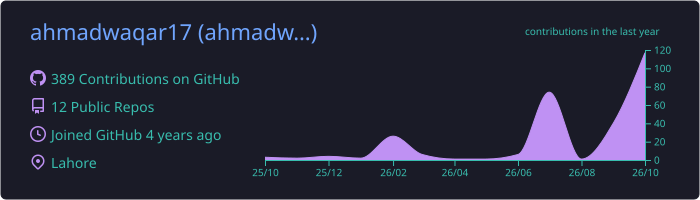
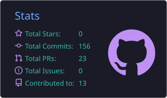
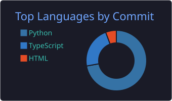

<!-- ===================== HEADER ===================== -->

  
   
  

  

  
  
  

---

<!-- ===================== ABOUT ===================== -->
##  About Me

<table>
<tr>
<td width="60%" valign="top">

I'm a backend engineer from **Lahore, Pakistan** 🇵🇰 who builds production-ready web platforms with **Python and Django**, and brings them to life with **LLM-powered features** — agents, RAG pipelines, and structured-output systems.

- 🔭 Currently at **Folium AI**, building backend systems for AI-driven learning
- 🏢 Previously at **Stack360**, shipping LLM solutions for document classification & data extraction
- 🎓 CS graduate of **FAST NUCES, Lahore**
- 🧠 Into AI agents, tool-calling, RAG, multi-tenant SaaS & scalable async architectures
- ⚡ Fun fact: I'd rather write a Celery task than wait for anything synchronously

</td>
<td width="40%" align="center">
  
</td>
</tr>
</table>

---

<!-- ===================== EXPERIENCE ===================== -->
## 💼 Experience

<table>
  <tr>
    <th align="left">Role</th>
    <th align="left">Company</th>
    <th align="left">Duration</th>
  </tr>
  <tr>
    <td>🟢 <b>Associate Software Engineer</b></td>
    <td><b>Folium AI</b></td>
    <td></td>
  </tr>
  <tr>
    <td>⚪ <b>Associate Software Engineer</b></td>
    <td><b>Stack360</b></td>
    <td></td>
  </tr>
</table>

---

<!-- ===================== PROJECTS ===================== -->
## 🚀 Featured Projects

<table>
<tr>
<td width="33%" valign="top">

### 📑 Altertia Compliance
<i>Multi-tenant compliance automation for enterprises</i>

- 🤖 LangChain agents classify CFDI, IMSS, SAT & Infonavit docs and return structured JSON
- 🔐 Secure uploads, validation & organized storage for Mexican compliance workflows
- ⚙️ Large batches processed async with Celery + Redis
- 📋 Auditable storage for transparent reporting

</td>
<td width="33%" valign="top">

### 💰 MoneyTalks (WealthWise)
<i>Scalable multi-tenant SaaS learning platform</i>

- 🏛️ Strict data isolation across org hierarchies with Django Tenants
- 🗣️ DB-powered RAG — agents query PostgreSQL in natural language
- 👥 RBAC for students, teachers & admins
- 📈 Modular lesson engine, progress tracking, dashboards & portfolios

</td>
<td width="33%" valign="top">

### ⚖️ E-Wakeel
<i>LegalTech platform for clients, advocates & admins</i>

- 💬 Real-time advocate–client chat over WebSockets
- 🤖 Gemini-powered chatbot for legal queries
- 📂 Role-based dashboards & secure document sharing
- ⏰ Automated court hearing alerts

</td>
</tr>
</table>

---

<!-- ===================== TECH STACK ===================== -->
## 🛠️ Tech Stack

<b>Languages</b>

  

<b>Frameworks & Libraries</b>

  
   
  
  
  

<b>Databases</b>

  
   
  

<b>DevOps & Tools</b>

  
   
  

<b>🧠 AI & LLM Engineering</b>

  
  
  
  
  
  
  
  
  

---

<!-- ===================== STATS ===================== -->
## 📊 GitHub Stats

  

  
  

  

  

<!-- ===================== SNAKE ===================== -->

  <picture>
    <source media="(prefers-color-scheme: dark)" srcset="https://raw.githubusercontent.com/ahmadwaqar17/ahmadwaqar17/output/github-snake-dark.svg" />
    <source media="(prefers-color-scheme: light)" srcset="https://raw.githubusercontent.com/ahmadwaqar17/ahmadwaqar17/output/github-snake.svg" />
    
  </picture>

---

<!-- ===================== FOOTER ===================== -->

  

